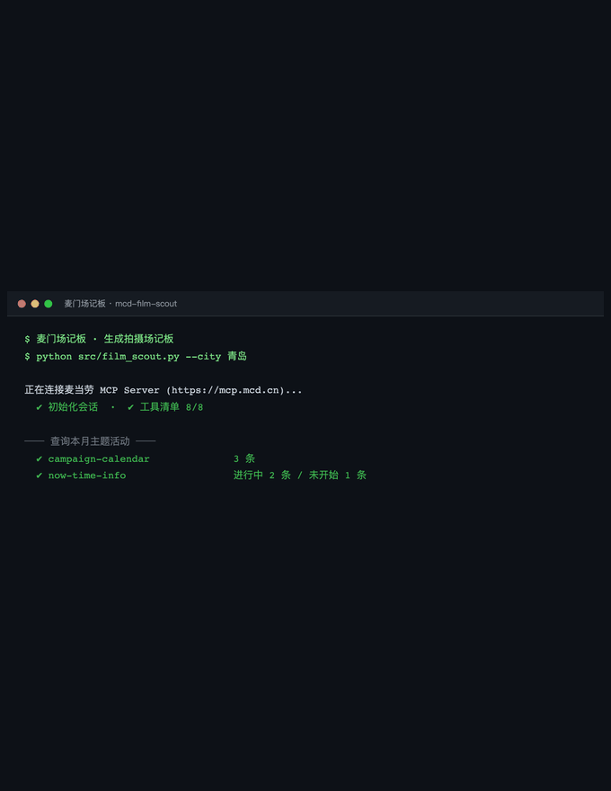

# 麦门场记板 · MCD Field Notes

> 给摄影师和内容创作者的**麦当劳主题活动取景与拍摄策划助手**。
> 基于麦当劳中国官方 MCP Server（`https://mcp.mcd.cn`）开发，
> 在 WorkBuddy 中以 Skill 形式运行。



*从「我想拍个麦当劳活动」到一份完整场记板，全程一次对话。*

---

## 它解决什么问题

麦当劳中国的「主题活动」（派对、品鉴会、主题门店）有一个现实问题：
**活动名额有限、门店有限、场次有限，而且一个月就换一批。**

摄影师想拍一个主题活动成片，常见的时间线是：

- 刷到别人发的活动帖 → 想知道自己城市有没有
- 打开活动页 → 发现只有指定城市的指定门店有
- 想约场次 → 不知道哪天有空位
- 到了店里 → 不知道拍什么、怎么构图、光线怎么用
- 顺便点单 → 不知道哪家店有什么主题餐品

这条链上每一步都要手动搜。本 Skill 把它压成**一次对话**。

## 核心能力

| 能力 | 说什么 | 背后调用的麦当劳 MCP 工具 |
|---|---|---|
| **活动盘点** | 「这个月有什么好玩的麦麦活动」 | `campaign-calendar`、`now-time-info` |
| **就近找场** | 「我在青岛，有没有能约的主题活动」 | `query-nearby-stores`、`query-party-city`、`query-party-store` |
| **排期约场** | 「下周哪天有空位」 | `query-partystore-date`、`query-partystore-session` |
| **拍摄预案** | 「这场怎么拍」 | `campaign-calendar` + `query-meals` + `list-nutrition-foods` |
| **点单补充** | 「顺便看看主题餐品和券」 | `query-meals`、`query-meal-detail`、`query-store-coupons`、`available-coupons` |

## 独特之处

赛道上的参赛项目大多在**省钱**、**营养**、**点餐决策**上卷。
本项目换了个坐标轴：**不做消费决策，做创作决策。**

麦当劳 MCP 提供的活动日历、主题活动门店、场次与菜单数据，
原本是被用来回答「今天吃什么、怎么买划算」的。
本项目把它们重新解释为**拍摄场次表**：

- `campaign-calendar` 的每一条活动 → 一次**可拍摄的主题**
- `query-party-city` / `query-party-store` → **取景地清单**
- `query-partystore-session` 的场次 → **档期表**
- `query-meals` 的主题餐品 → **画面里的道具与色彩参考**
- `list-nutrition-foods` → 拍摄间隙的**补给建议**（连续拍摄要吃东西）

输出不是一张优惠券清单，是一份**场记板**：去哪、什么时候、拍什么、怎么拍、顺带吃什么。

## 目标用户

- 商业摄影师 / 城市风光与美食摄影爱好者
- 美食探店类内容创作者
- 摄影培训讲师与学员（可用作课堂实战案例）
- 想记录城市商业空间变化的人

## 快速开始

### 1. 申请 MCP Token

访问 <https://open.mcd.cn/mcp> → 右上角【登录】（手机号验证）→ 【控制台】→【激活】→ 同意服务协议 → 复制 Token。

### 2. 配置 MCP

在 WorkBuddy 中：左侧边栏【专家·技能·连接器】→【连接器】→ 右上角【自定义连接器】→【配置MCP】，填入：

```json
{
  "mcpServers": {
    "mcd-mcp": {
      "type": "streamablehttp",
      "url": "https://mcp.mcd.cn",
      "headers": {
        "Authorization": "Bearer YOUR_MCP_TOKEN"
      }
    }
  }
}
```

> 把 `YOUR_MCP_TOKEN` 替换为真实 Token，保存后启用 `mcd-mcp`。

### 3. 安装本 Skill

```bash
git clone https://github.com/mengboqingdao/mcd-film-scout.git
cp -r mcd-film-scout ~/.workbuddy/skills/
```

重启 WorkBuddy 后即可使用。

## 使用示例

**示例一：找活动**
> 我在青岛，帮我看看这个月附近有没有能约的麦当劳主题活动，我想去拍一组片。

**示例二：排期**
> 青岛有哪些门店做主题活动？下周三有哪几场还有空位？

**示例三：拍摄预案**
> 帮我规划一下这场活动怎么拍：主体、构图、光线、色彩各给一套方案，再推荐当天在店里能点到的套餐。

**示例四：顺路补给**
> 我在市南区中午拍片，附近哪家店能自提？有什么券能用？顺便给我一份低负担的午餐建议（拍摄中间要吃）。

## 项目结构

```
mcd-film-scout/
├─ README.md                    本文件
├─ CONTEST_DECLARATION.md       参赛声明（官方原文，内容不可改动）
├─ MCP_INTEGRATION.md           麦当劳 MCP 集成说明：工具、调用流程、业务价值
├─ mcp-config.example.json      脱敏后的 MCP 配置示例
├─ workbuddy.md                 WorkBuddy 开发对话上下文
├─ LICENSE                      MIT
├─ .gitignore
├─ docs/
│  ├─ demo.gif                 一分钟演示动画（README 首屏）
│  └─ hero.png                 演示末帧静态图
└─ src/
   ├─ mcd_client.py             麦当劳 MCP 客户端封装（含工具白名单）
   ├─ film_scout.py             场记板核心：活动→场次→拍摄预案
   └─ skill/
      ├─ SKILL.md               WorkBuddy Skill 定义
      └─ references/
         └─ shot-notes.md      拍摄预案的镜头语言参考
```

## 安全说明

- Token **只从环境变量 `MCD_MCP_TOKEN` 读取**，源码与配置文件中不含任何真实凭证
- 客户端内置**工具白名单**，只封装本项目实际使用的 8 个工具
- 本项目**只读**：不下单、不支付、不创建订单、不修改账户
- 所有输出仅为拍摄与行程建议，餐品信息与价格以麦当劳官方渠道实时结果为准

## 免责声明

本项目为麦当劳程序员节创意开发大赛参赛作品，由参赛者独立开发，
**非麦当劳官方产品**。项目输出仅供参考，不构成医疗、营养或其他专业建议；
餐品信息、价格及供应状态以麦当劳官方渠道的实时结果为准。

## License

MIT
